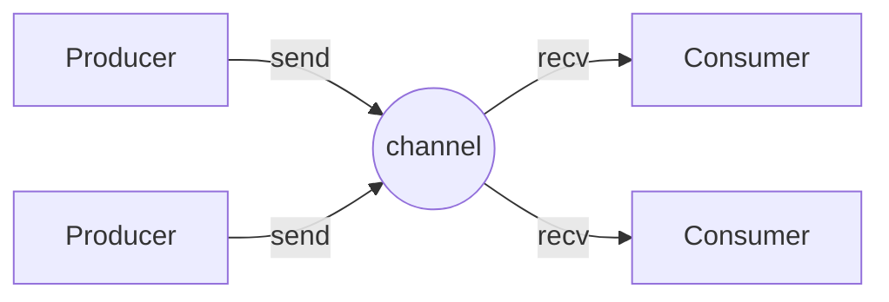

<div align="center">

# 📡 chann

**Go-style channels for Rust: multi-producer, multi-consumer, with a real `select`.**

[](https://github.com/alex-quiterio/chann/actions/workflows/ci.yml)
[](#-license)
[](Cargo.toml)
[](src/lib.rs)
[](#%EF%B8%8F-status)

[Quick start](#-quick-start) ·
[Channel kinds](#-three-kinds-of-channel) ·
[`chan_select!`](#-chan_select) ·
[Coming from Go](#-coming-from-go) ·
[Examples](#-examples) ·
[Layout](#%EF%B8%8F-project-layout)

</div>

---

The crate in this repository is named **`chan`**. It gives you the toolkit Go
programmers reach for without thinking:

- 🔁 **Rendezvous, buffered and unbounded channels.** All of them share the
  same `Sender<T>` / `Receiver<T>` types, so you can mix them freely.
- 🎯 **`chan_select!`** waits on any mix of sends *and* receives, with an
  optional non-blocking `default` arm.
- ⏰ **Timers**: `after` fires once, `tick` fires forever.
- 👥 **`WaitGroup`**, to wait for a set of threads to finish.
- 🧵 **Plain OS threads**. There is no runtime, no executor and no `unsafe`.

> [!WARNING]
> ### ⚠️ Status
>
> **Use this crate for learning or for code that already depends on it, not
> for new projects.**
>
> It builds and passes its tests on current stable Rust with no warnings. It
> stays on the 2015 edition because one of its public functions is named
> `async`, which became a keyword in 2018.

---

## 🚀 Quick start

The crate isn't published from this repository, so depend on it through git:

```toml
[dependencies]
chan = { git = "https://github.com/alex-quiterio/chann" }
```

Then use it:

```rust
use std::thread;

fn main() {
    let (tx, rx) = chan::sync(0);          // a rendezvous channel
    thread::spawn(move || {
        for i in 1..=3 {
            tx.send(i);
        }
    });                                     // tx is dropped here, which closes the channel
    for v in rx {                           // receivers are iterators
        println!("got {}", v);
    }
}
```

<details>
<summary><b>Requirements</b></summary>

- Rust stable and Cargo (checked with Rust 1.99).
- One runtime dependency: `rand` 0.3, used to shuffle the arms of `chan_select!`.
- The benchmarks need a nightly compiler (`#![feature(test)]`).

</details>

---

## 🔀 Three kinds of channel

Every constructor returns a `(Sender<T>, Receiver<T>)` pair. Both halves can
be cloned and moved to other threads as often as you like.

| Constructor     | Kind                    | `send` blocks...                  |
|-----------------|-------------------------|-----------------------------------|
| `chan::sync(0)` | 🤝 rendezvous           | until a `recv` takes the value    |
| `chan::sync(n)` | 📦 buffered, `n` slots  | while the buffer is full          |
| `chan::async()` | ♾️ unbounded            | never                             |



**Closing.** A channel closes when its **last `Sender` is dropped**. After
that, `recv` drains whatever is still buffered and then returns `None` at
once. There is no explicit `close`.

---

## 🎯 `chan_select!`

Here a loop selects on a ticker, a timeout and a non-blocking `default` arm,
in a crate on the 2018 or 2021 edition:

```rust
use std::thread;
use std::time::Duration;

use chan::chan_select;

fn main() {
    let tick = chan::tick(Duration::from_millis(100));
    let boom = chan::after(Duration::from_millis(500));
    loop {
        chan_select! {
            default => thread::sleep(Duration::from_millis(50)),
            tick.recv() => println!("tick."),
            boom.recv() => { println!("BOOM!"); return; },
        }
    }
}
```

> [!NOTE]
> In a **2015-edition** crate, use `#[macro_use] extern crate chan;` instead
> of the `use` line. In **2018 and later**, the unbounded constructor has to
> be written `chan::r#async()`.

### The rules

`chan_select!` is strict, and breaking a rule gives you an unhelpful
*"recursion limit reached"* error:

| ✅ Do                                                    | ❌ Don't                                  |
|----------------------------------------------------------|-------------------------------------------|
| End **every** arm with a comma, braces or not            | Leave the last arm without a comma        |
| Put `default` **first**, if you use it                   | Put `default` anywhere else               |
| Use `ident.recv()` or `ident.send(expr)`                 | Call `foo.bar.recv()` or `get().recv()`   |
| Bind a received value with `-> name` (an `Option<T>`)    | Expect a bare `T`                         |

### Gotchas

- 🕳️ **Dropping every `Receiver` does not close a channel.** A send that has
  to wait for a receiver (a full buffer, or any rendezvous send) then blocks
  forever.
- 🧟 `tick` and `tick_ms` start a thread that is never reclaimed.
- 🚫 There is no `try_send` or `try_recv`. Use `chan_select!` with a
  `default` arm instead.
- 🪞 Two `chan_select!`s can't rendezvous with each other on the same
  unbuffered channel. One side must be a plain blocking `send` or `recv`.

`cargo doc --open` covers all of this in more depth, with an example for each
pattern.

---

## 🐹 Coming from Go

| Go                              | chann                                        |
|---------------------------------|----------------------------------------------|
| `ch := make(chan int)`          | `let (tx, rx) = chan::sync(0);`              |
| `ch := make(chan int, 8)`       | `let (tx, rx) = chan::sync(8);`              |
| `ch <- v`                       | `tx.send(v);`                                |
| `v, ok := <-ch`                 | `let v: Option<i32> = rx.recv();`            |
| `for v := range ch { }`         | `for v in rx { }` or `for v in &rx { }`      |
| `close(ch)`                     | drop every `Sender`                          |
| `select { case ...: default: }` | `chan_select! { default => ..., ... }`       |
| `time.After(d)`                 | `chan::after(d)`                             |
| `time.Tick(d)`                  | `chan::tick(d)`                              |
| `sync.WaitGroup`                | `chan::WaitGroup` (`add`, `done`, `wait`)    |
| `go f()`                        | `std::thread::spawn(f)`                      |

---

## 🧪 Examples

```sh
cargo run --example default        # the select loop above
cargo run --example fibonacci      # select on a send and a receive
cargo run --example leaky_buffer   # Go's "leaky buffer" free list
cargo run --example nested_select  # nested selects to prioritise a channel
```

---

## 🗂️ Project layout

```
src/lib.rs          channel types, constructors, timers, chan_select!, unit tests
src/select.rs       Select, the type-erased engine behind chan_select!
src/notifier.rs     lets a blocked select subscribe to channel activity
src/tracker.rs      counts senders and receivers so the last sender closes
src/wait_group.rs   WaitGroup
examples/           runnable examples
benches/            throughput benchmarks against std::sync::mpsc (nightly)
BENCHMARKS.md       one recorded benchmark run from upstream
```

---

## ✅ Tests and benchmarks

```sh
cargo test             # unit tests and doc examples (a few seconds; some tests sleep)
cargo +nightly bench   # throughput against std::sync::mpsc
```

---

## 📜 License

Dual-licensed under **MIT** or the **[Unlicense](https://unlicense.org)**, at
your option. See [`COPYING`](COPYING), [`LICENSE-MIT`](LICENSE-MIT) and
[`UNLICENSE`](UNLICENSE).

<div align="center">
<sub>Originally written by <a href="https://github.com/BurntSushi">Andrew Gallant</a>. Kept alive here for learning.</sub>
</div>
